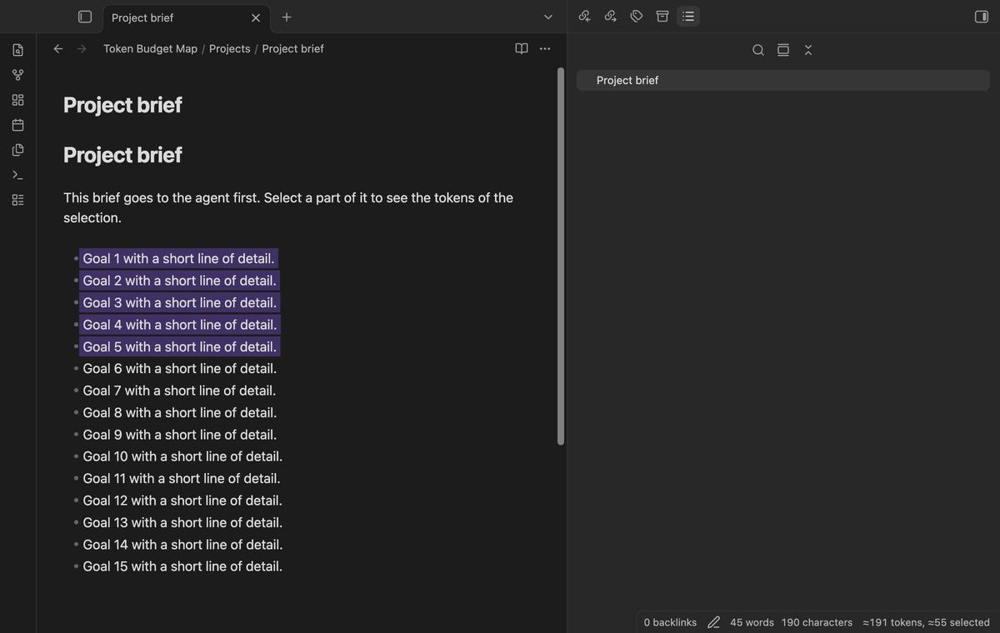
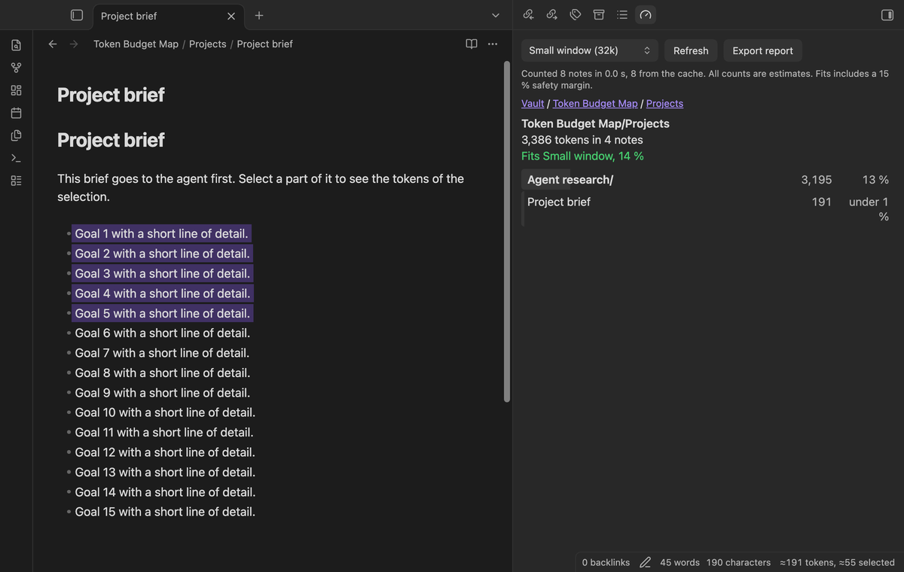
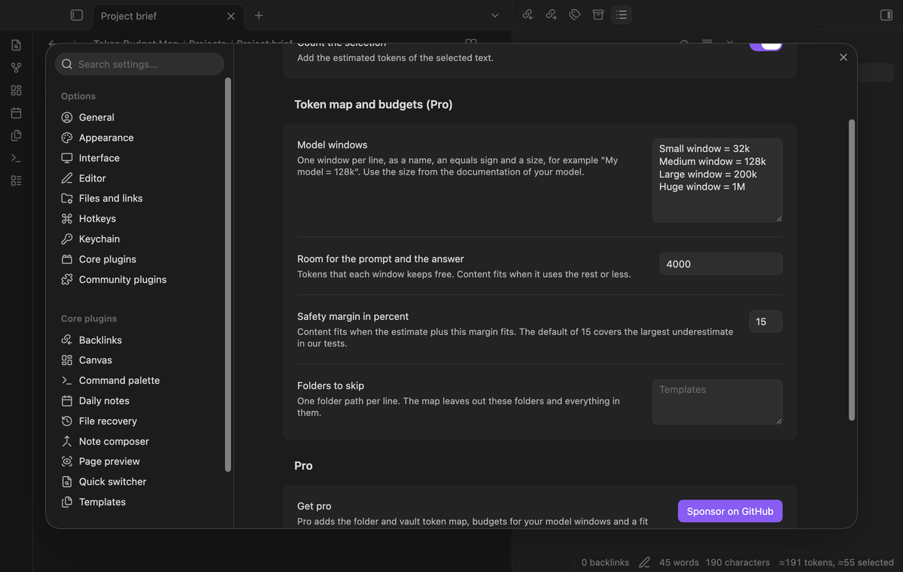
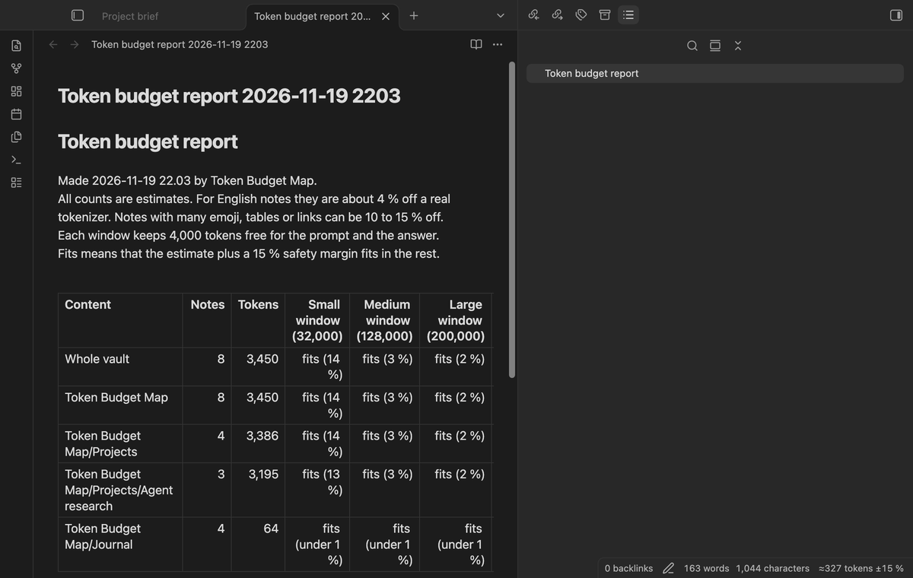
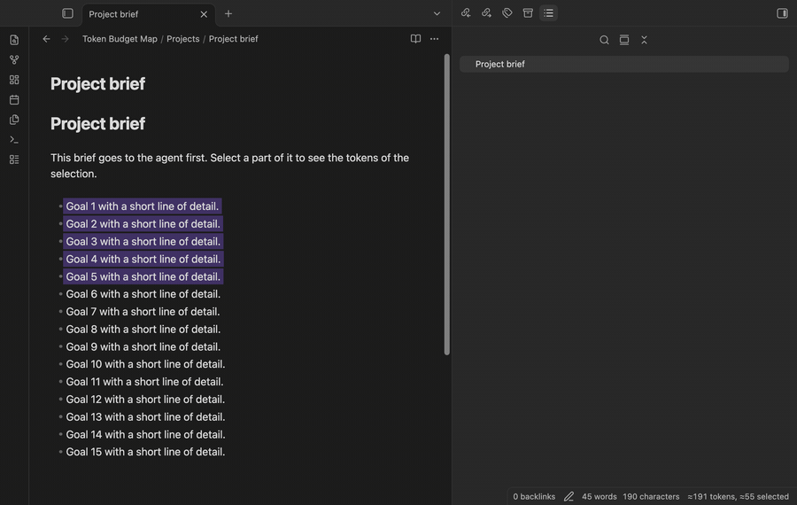

# Token Budget Map

Shows the token count of notes, folders and the vault before you give them to an AI agent.

AI agents in Obsidian read your notes as tokens. Copilot, Claudian, Claude Code and Codex all have a context window, and a large folder can fill it before the agent starts work. Token Budget Map counts the tokens on your device first. You see what a note, a folder or the whole vault costs, and whether it fits the window of your model.

All counts are estimates. The plugin does not send note text anywhere, and it does not bundle a model tokenizer. See the FAQ for how the estimate works and how close it is.

## Features

### Token count in the status bar

The status bar shows the estimated tokens of the active note, for example `≈1,234 tokens`. When you select text, it adds the selection, for example `≈1,234 tokens, ≈56 selected`. The count follows your typing with a short delay, so it rarely slows the editor. The count uses the text in the editor, so unsaved changes count too. A note with emoji, base64 data, Chinese, Japanese or Korean text, code blocks, large tables or many links shows `(rough)`. The tooltip gives the error range that we measured for that kind of note. This feature is free.



### Folder and vault token map (Pro)

The token map is a side view. It lists the folders and notes of a folder, the largest first, with their tokens and their share of the chosen window. A shaded bar shows the share. A row that does not fit turns red. Select a folder to open it, and select a note to open the note. The path at the top takes you back up.



### Budgets for your model windows (Pro)

You keep a list of context windows in the settings, one per line, such as `My model = 128k`. The plugin ships 4 neutral sizes with no model names. Enter the window size from the documentation of the model that you use. You also set the room that each window keeps free for the prompt and the answer. Each note gets a margin, the largest underestimate that we measured for its kind. Content fits when the estimate with its margin uses the rest or less. Near the limit means that the estimate fits but the margin does not.



### Fit report (Pro)

The fit report is a new note in your vault. It has one row for the whole vault and one row for each of the 200 largest folders. Each window gets a column, and each cell says fits or does not fit, with the share in percent.



## Install

When Token Budget Map is listed in the community directory, open Settings, then Community plugins, then Browse, and search for "Token Budget Map". Select Install, then Enable.

To install by hand, download `main.js`, `manifest.json` and `styles.css` from the latest release. Put the three files in `<vault>/.obsidian/plugins/token-budget-map/`. Restart Obsidian or reload the list of community plugins, then turn on Token Budget Map.

## Usage

Open a note. The status bar shows its estimated tokens. Select some text to see the tokens of the selection as well.

To see the token map, select the count in the status bar, or run "Open the token map". The view opens in the right sidebar. Choose a window in the list at the top. The view counts the vault the first time it opens. Later counts read only the notes that changed, so they are fast.

While the view is open, the map follows your edits. When a note changes, the view counts again after 2 seconds. Run "Count the vault again" to start a count yourself.

To make a report, select "Export report" in the view, or run "Export the fit report". The plugin writes a note named after the date and time, for example `Token budget report 2026-11-19 2105.md`, and opens it.

The vault count runs in small parts, so you can type while it works. In our test, 10,000 notes took less than 2 seconds.



## Settings

### Count in the status bar

Turn the status bar count on or off.

### Count the selection

Turn the selection part of the status bar count on or off.

### Model windows

One window per line, as a name, an equals sign and a size. Sizes can be plain numbers, or use k for thousands and M for millions. Examples are `Team model = 200k` and `Long model = 1M`. A line that starts with # is a comment. A wrong line shows an error under the box, and the other lines still work.

### Room for the prompt and the answer

Tokens that each window keeps free. The default is 4,000. An agent also needs room for its own instructions, your question and its answer.

### Extra safety margin in percent

An extra margin on top of the measured margin of each note. The default is 0.

### Folders to skip

One folder path per line, for example `Templates`. The map and the report leave out these folders and everything in them.

### Pro

Sign in with GitHub to turn on Pro. See "Payment, account and network" below.

## FAQ

### How exact are the counts?

The counts are estimates for every model. The plugin splits the text the way tokenizers do, into words, numbers, punctuation and spaces, and gives each part a cost. We checked it against the o200k tokenizer of OpenAI on 38 new notes that nobody used to tune it. These ranges are estimates from a small test, not limits.

| Kind of note | Notes | Error range per note | Margin in the fit test |
|---|---:|---|---:|
| Plain prose | 9 | 3 % under to 9 % over | 8 % |
| Emoji | 5 | 38 % under to 8 % under | 38 % |
| Base64 data and tokens | 4 | 24 % under to 1 % under | 38 % |
| Chinese, Japanese and Korean | 6 | 23 % under to 7 % over | 23 % |
| Code blocks | 11 | 10 % under to 17 % over | 12 % |
| Tables | 5 | 14 % under to 11 % over | 14 % |
| Many links | 3 | 4 % under to 11 % over | 8 % |

The margin is the largest underestimate seen for that kind of note in all our tests, with a floor at the prose margin. A note with emoji or base64 data gets the largest margin.

### Why no exact tokenizer?

An exact tokenizer would add 1 to 2 MB to the plugin and would still be exact for one model family only. Claude and Gemini models use other tokenizers, and we did not measure them. Add an extra margin if you work with them.

### Does it work for other languages?

Yes, with the error ranges in the table above. Cyrillic, Arabic and other scripts were not measured, so treat their count as a guide.

### Which files does it count?

Markdown notes only. Frontmatter counts, because agents read it too. PDFs, images and canvas files are not counted.

## Payment, account and network

The core features are free. Pro features need a GitHub Sponsors sponsorship of theluckystrike: $5 a month or more, or $15 once. A total payment of $15 meets the payment requirement for Pro without further payment. Sign-in and the checks below still apply. Your notes stay readable and editable with or without Pro.

[One payment turns on Pro in every NoteMods plugin](https://notemods.com/pro/).

GitHub handles the payment. Sponsor at https://github.com/sponsors/theluckystrike/sponsorships?tier_id=666162&frequency=one-time&metadata_source=token-budget-map. You need no account for the free features. Pro needs the GitHub account that sponsors.

Until you select "Sign in with GitHub" in the settings, Token Budget Map makes no network requests. Sign in uses the GitHub device flow. Token Budget Map sends its public client ID and the scope `read:user` to `https://github.com/login/device/code` and shows you a code. While you enter the code at https://github.com/login/device, it asks `https://github.com/login/oauth/access_token` every few seconds to check the sign-in status. The scope permits profile reads only. GitHub needs this access to show the sponsorship tier. It grants no repository scope and no write access.

After sign in, Token Budget Map sends one query to `https://api.github.com/graphql`. It checks if the signed-in account sponsors theluckystrike. It asks for the tier and the total payment to theluckystrike. The plugin reuses a successful check for 7 days. Failed checks can retry after 6 hours. Select Refresh to request an earlier check. It sends no note content, file names or other vault data, and it has no telemetry.

After a successful check, Pro can work offline for up to 14 days. Sign out or a negative sponsorship answer turns Pro off. The plugin stores the GitHub token through the secret storage API of Obsidian. It does not put the token in its saved settings or its local sponsorship data. The local storage of this device keeps your GitHub login, the tier and the time of the last check. Sign out clears the token. You can also revoke the access in your GitHub settings, under Applications.

## Support

Report a bug or ask for a feature in the issue tracker of this repository. Add your Obsidian version and a short example. To support the work, use [GitHub Sponsors](https://github.com/sponsors/theluckystrike).

```
npm ci
npm run build
npm test
```

## License

MIT
